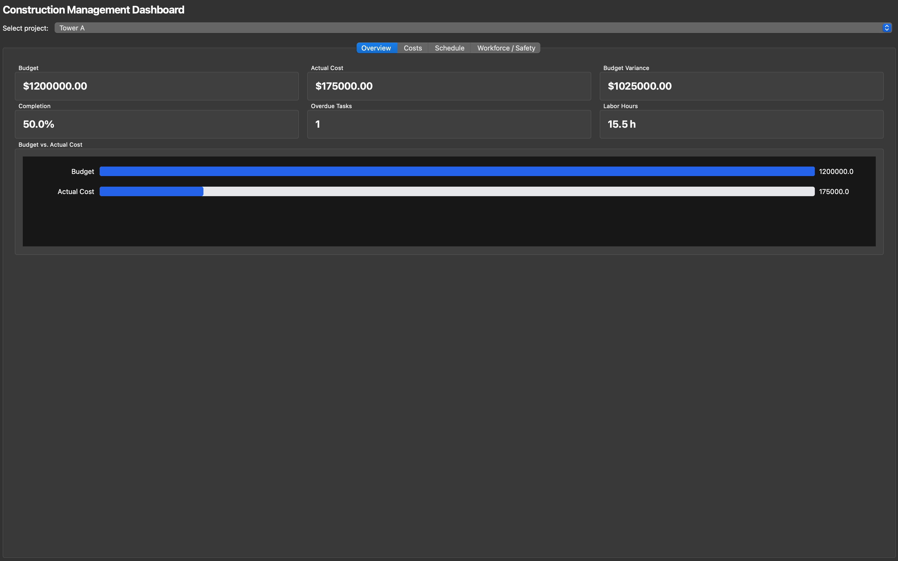
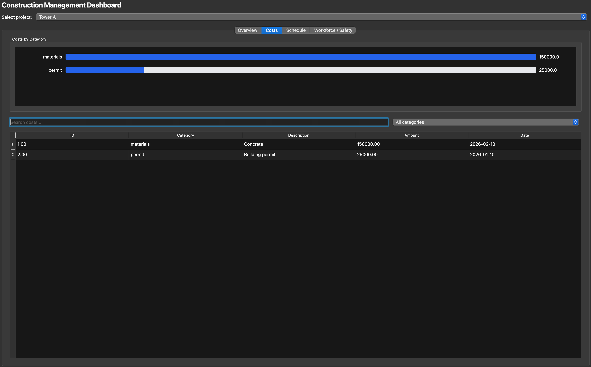
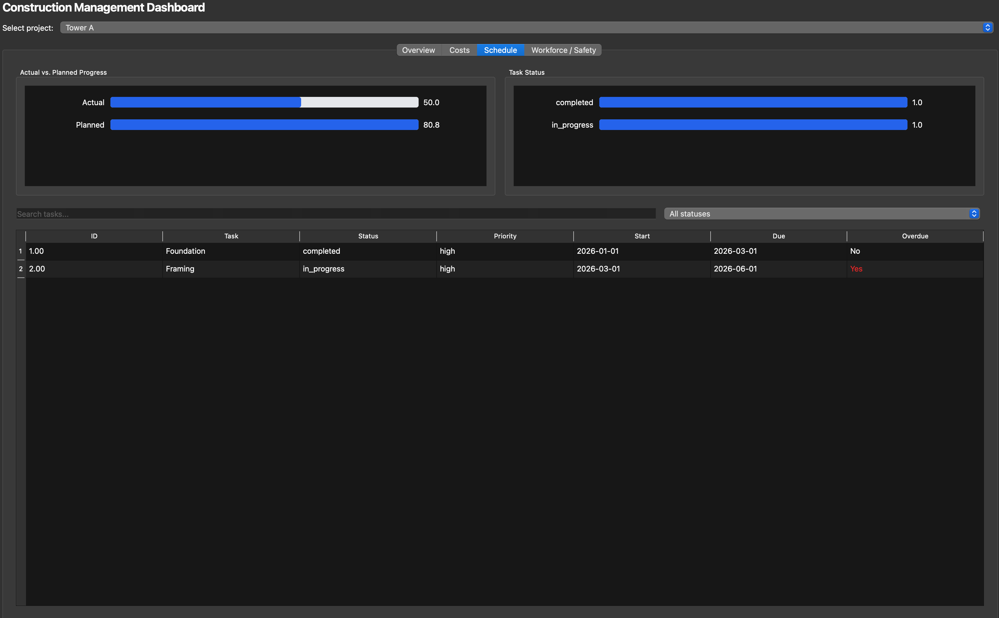
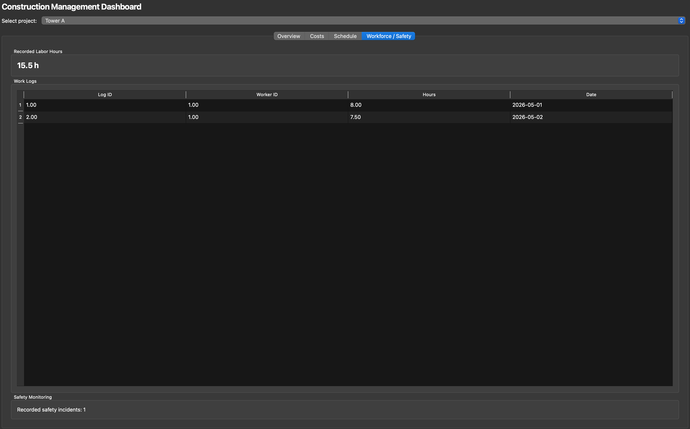

# Construction Management Dashboard

A desktop application for monitoring construction projects using **C++17, Qt6, SQLite and CMake**.

## Features

- Project selection and overview
- Budget versus actual spending
- Cost breakdown by category
- Task status and schedule progress
- Overdue task tracking
- Workforce labor-hour monitoring
- Safety incident counts
- Search filters and sortable tables
- CSV validation
- Logging and database error handling
- Automated unit tests
- GitHub Actions CI
- AddressSanitizer and UndefinedBehaviorSanitizer support

## Technologies

| Component | Technology |
|---|---|
| Language | C++17 |
| Interface | Qt6 Widgets |
| Database | SQLite |
| Build | CMake |
| Testing | Google Test |
| CI | GitHub Actions |

## Architecture

See [Architecture](docs/architecture.md).

## Build and Run

Requires CMake, a C++17 compiler, Qt6 Core/Widgets/Sql and the Qt SQLite driver.

```bash
cmake -S . -B build -DBUILD_TESTING=ON
cmake --build build
./build/ConstructionDashboard
```

## Tests

```bash
ctest --test-dir build --output-on-failure
```

## Sanitizers

```bash
cmake -S . -B build-sanitized \
  -DCMAKE_BUILD_TYPE=Debug \
  -DBUILD_TESTING=ON \
  -DENABLE_SANITIZERS=ON

cmake --build build-sanitized
ctest --test-dir build-sanitized --output-on-failure
```

## Screenshots

### Overview



### Costs



### Schedule



### Workforce and Safety



## Sample Dataset

Example CSV records are in `data/sample/`.

Import only datasets supported by the application's CSV importer. The files are not automatically inserted into SQLite.

## Demo Instructions

1. Build and start the application.
2. Ensure sample project records exist in the SQLite database.
3. Select a project.
4. Inspect budget, spending and completion on Overview.
5. Open Costs and filter by category.
6. Open Schedule and filter overdue tasks.
7. Open Workforce/Safety to inspect hours and incidents.
8. Run CTest to demonstrate automated verification.
9. Open GitHub Actions to inspect the latest CI results.

## Limitations

- Data is stored in a local SQLite database.
- Safety monitoring currently provides an incident count.
- CSV imports depend on implemented schema mappings.
- The application is designed primarily for local desktop use.

## Author

GitHub: [liltaya](https://github.com/liltaya)

Repository: [Construction-dashboard](https://github.com/liltaya/Construction-dashboard)

