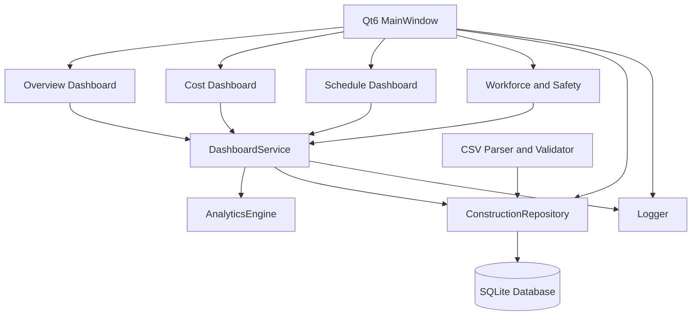

# Construction Dashboard Architecture

## Components

### Presentation Layer
Qt Widgets renders dashboards, tables, charts,
filters and project selection.

### Service Layer
DashboardService manages project operations and
coordinates analytics.

### Analytics Layer
AnalyticsEngine calculates spending, budget variance,
completion, overdue tasks and labor hours.

### Repository Layer
ConstructionRepository provides prepared SQL queries
for storing and retrieving records.

### Database Layer
Database manages SQLite connections and schema setup
using RAII.

### CSV Layer
CSV parsing and validation support data import.

### Logging
Logger records operational and error messages.
